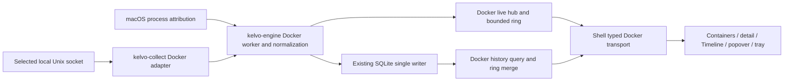

# Docker container monitoring

**Status:** Implemented and merged to `main`; real-world release acceptance remains open. **Date:** 2026-10-11.

The reviewed implementation (`73f485c`) and verification record (`4f35d32`) were
fast-forwarded into `main` from `4c44aae`. The user explicitly requested merge,
cleanup and push after the outstanding acceptance checks were reported. The
feature worktree and `codex/docker-container-monitoring` branch are removed.

Execution tracking (dependency order): A partial
([evidence](docker-container-monitoring-compatibility.md)); B–G implemented,
verified and review-approved; H1–H3 retain the outstanding real-world acceptance
checks. Integration is authorized with those checks deferred as follow-ups; this
does not mark them passed or claim a released binary.

Final verification: `make check` passed (814 Rust/939 frontend tests), all 262
functional Chromium/WebKit browser cases passed, all 10 Chromium performance
gates passed (10 expected WebKit skips), generated bindings reproduced exactly,
and installed OrbStack adapter/worker checks passed. Architecture, database and
UI `ce:code-reviewer` reviews approved the fixes with no remaining findings.
Docker overview/detail measured 27.54/20.92 ms/s against unchanged 35 ms/s limits,
with no long tasks. Docker uses schema v6 after remote sync's v5 migration.

Follow-ups remain: integrated 24-hour soak; whole-app module-off/on overhead and
daemon/VM CPU/energy measurements; controlled 32/128/200-container timing and
aligned end-to-end CPU/memory accuracy; actual Docker Desktop/Colima runtime
validation. The user authorized OrbStack validation and the documented common
Docker Engine API surfaces. Hardware checks must run under valid benchmark
conditions. See [PROGRESS.md](PROGRESS.md) for evidence and acceptance details.

Add a Containers tab that answers two questions: “How much of my Mac is Docker using?” and “Which container explains it?” Show the selected local engine's container workload alongside the macOS runtime processes that support it, with explicit measurement boundaries. Keep container history and lifecycle evidence so an earlier spike remains explainable.

This is a local macOS feature, staged independently of the numbered roadmap. It does not implement the remote Linux cgroup/Podman/systemd work in [v4](v4-remote-hosts.md). The plan applies `ce:planning-products`, `ce:design`, `ce:architecting-systems`, and `ce:managing-databases`; repository conventions take precedence. [D-103](decisions.md#d-103-local-docker-monitoring-has-its-own-clock-and-history) records the persistence decision.

## 1. Problem, evidence, and scope

The first user is a developer running local Compose projects who sees high CPU or memory in Kelvo but can only attribute it to a Docker runtime or VM. They switch to Docker tooling to find the workload, and lose the connection between current container stats and an earlier host spike. The intended feeling is confidence: identify the workload, see the evidence, and understand where measurement stops.

The feature request and supplied mocks establish demand and an initial direction. They do not establish prevalence or validate usability. Docker's own [stats semantics](https://docs.docker.com/reference/cli/docker/container/stats/) establish the expected CPU and memory units; its [event interface](https://docs.docker.com/reference/cli/docker/system/events/) supplies lifecycle evidence but only retains the latest 256 events. Kelvo's opportunity is a local history and attribution workflow that fits its existing monitor.

| Job | Experience | Success check |
|---|---|---|
| Find the costly workload now | Open Containers, scan CPU or memory, open the row | Find the top consumer within 10 seconds in a moderated task |
| Explain an earlier spike | Select a time range, open the affected container, inspect chart and events | Locate a recorded OOM and its preceding memory pattern within 30 seconds |
| Understand Docker's impact on the Mac | Compare container workload with separately labelled runtime-process footprint | User can explain why these figures are not additive |
| Keep an eye on a project | Optional popover/count and Timeline integration | Reach the same engine/container/time from each surface |

Task-time targets apply to supported, fully monitored populations; a partial population must never claim to identify the global top consumer. Validate with 0, 1, 32, 128 and 200-container fixtures and real engines. There is no new telemetry; validation is local and volunteered.

**Must:** one selected local Docker Engine; Docker Desktop plus compatibility testing for OrbStack and Colima; aggregate and per-container live metrics; grouped/searchable inventory; detail, historical metrics, lifecycle/OOM evidence, bounded on-demand logs; honest partial and unavailable states. Monitoring is opt-in. Containers remains discoverable before setup.

**Staged after the core tab:** Timeline lane and event links, optional popover summary and tray count. These consume the same facts and do not create independent collectors.

**Deferred:** remote engines, simultaneous monitoring of multiple engines, Podman/Kubernetes/containerd adapters, lifecycle actions, terminal/exec, image/volume cleanup, builds, Compose editing, disk-image capacity scanning, notifications/alert rules, log storage/export, and v2 widget authoring. Docker installation is the user's existing environment; Kelvo needs no Docker CLI, helper container, privileged helper, or permission-changing setup command.

## 2. Experience and visual direction

Use Kelvo's existing Utility & Function / Data & Analysis direction: dense table, restrained chart treatment, native SF Pro, sentence-case labels, `.figures` for updating numbers, and `.figures-display` for headline figures. Apply [design-system.md](design-system.md), [D-101](decisions.md#d-101-sf-pro-for-the-ui-sf-pro-rounded-for-headline-figures-no-monospace-or-uppercase-labels), and the neighboring Processes and Network pages. New route designs must be compared in dark and light mode against those screens and the dev gallery.

The supplied local PDFs, `Containers (1).pdf`, `Container · worker (OOM loop) (1).pdf`, and `Containers · popover, tray, timeline (1).pdf`, in `plan/container-mocks/`, are inspiration. They are not tracked prerequisites for a clean checkout. Keep their useful aggregate-to-container hierarchy, Compose grouping and event context. Improve their wide clipped table, equally prominent stat cards, rainbow stacks and control-heavy detail. Do not carry over restart/stop/shell controls or environment-derived tuning advice.

### Setup and navigation

Add `/dashboard/containers` and `/dashboard/containers/:engineId/:containerId` in the existing dashboard. Selecting Containers while disabled shows the value proposition and Enable monitoring. On enable, prefer the configured Docker context if it targets a local Unix socket; otherwise choose the sole reachable local engine, or show a chooser. Read context configuration without invoking the CLI. Persist the selection separately from the CLI's active context; never silently switch when the selected engine disappears. The chooser shows runtime, context/profile, socket and connection state, with an explicit switch action.

Switching cancels the old engine's in-flight work and logs, resets rate baselines, opens a coverage gap and starts the selected engine. History stays attached to the original engine. Routes encode stable IDs, never container names. A historical detail link may open a removed container without reconnecting or changing the selected live engine.

### Overview

The container table is the primary surface. One compact summary and one chart support it; avoid a row of five equally weighted cards.

```text
Containers                 Docker Desktop · Connected       Engine…
8 running / 11 total       CPU 2.4 cores   Memory 3.1 / 8 GiB
Container workload · 8/8 measured · updated 1 s ago
[ CPU | Memory ]                              [15 min ▾]
┌ aggregate history, with gaps and lifecycle markers ─────────────┐
└───────────────────────────────────────────────────────────────┘
Runtime processes on this Mac     CPU 265%   Footprint 4.6 GiB ⓘ
[Search containers…]  [All states ▾]  [Grouped | Flat]  [CPU | I/O]
Name / image         State / health     CPU    Memory / limit  Restarts
▾ api-dev            3 running
  worker             Running / No check 140%   812 MiB / 1 GiB  3
  web                Running / Healthy   65%   240 MiB / —      0
▾ Standalone …
```

The headline CPU is occupied vCPU cores, with one core equal to 100% in per-container rows. Memory is the summed container working set against engine capacity, not the Mac's physical RAM or a sum of container limits. A detail tooltip states the definition. Engine capacity is an independently observed fact with age, not a guessed host denominator.

“Runtime processes on this Mac” shows verified runtime/VM process CPU and physical footprint separately. Its disclosure lists included processes, attribution confidence, measurement age and any shared-runtime scope. Do not add it to, subtract it from, or present its difference from container memory as “overhead.” When attribution is unavailable, keep the section with an explanation. For a shared OrbStack runtime, label shared usage rather than assigning it entirely to Docker.

Default history range is 15 minutes; use existing range controls and chart-window preferences, with explicit ranges through 30 days once persistence ships. CPU/memory is a compact switch. Network and block I/O live in secondary views and the I/O table column set. Search and table filters never change the engine summary. When looking back, keep the live table visibly labelled “Now”; the historical chart cannot imply its current rows describe that past moment.

Group by official Compose project/service labels, with a Standalone group and a flat option. Search name, image and project; filter lifecycle state; show stopped containers by default. Core columns are name/image, lifecycle and health, CPU, working-set memory, explicit memory limit, and restarts. Use column sets, truncation with accessible full values, and responsive disclosure instead of forcing every metric into a horizontal strip. No health check is “No check,” not “Healthy.”

Default sort is descending CPU, stable container ID as the tie-breaker. Freeze row order while the pointer is over the table or keyboard focus is interacting with rows; values keep updating. Show “Order paused” and a Reorder now action. Resume on leaving the table, and preserve selected/focused row identity. Keyboard sorting, grouping, row activation and engine choice must work without hover. Back from detail restores filter, sort, expansion and scroll state.

### Container detail and diagnosis

Lead with name, image, project, lifecycle/health and last-seen time. Show CPU and memory histories with historical limit changes; place network and block I/O below. Metadata includes ID, ports, mounts, CPU quota, restart policy, creation time and current state. Limit-pressure indicators use raw charged memory against the explicit limit, clearly distinct from the cache-adjusted working set chart. No explicit limit means “No explicit limit,” not zero or a fabricated container allowance.

Correlate lifecycle events with charts. “Repeated restarts” means at least three observed restarts in five minutes; show that window separately from Docker's cumulative restart count. Mark OOM only from an explicit Docker `oom` event or inspection evidence. Exit code 137 alone cannot prove OOM. Do not inspect environment variables or infer application tuning advice such as Node heap changes. Removed containers retain historical details until retention expires; empty history says why.

Logs are an explicit secondary pane. Opening fetches the latest 200 lines; Follow is separately enabled. Scrolling up pauses autoscroll with a new-lines count. Limit the buffer to 2,000 lines or 2 MiB, whichever comes first, and cap each line at 64 KiB with visible truncation. Handle both TTY output and Docker's multiplexed stdout/stderr framing, remove terminal control sequences, and render plain text. Cancel streams when the pane/window hides, the engine changes, monitoring pauses or the container disappears. Never persist logs, include them in telemetry, or export them automatically. Copy requires a user action. Unsupported logging drivers get a specific state and Docker-tool guidance.

### State contract

| State | Presentation and recovery |
|---|---|
| Disabled | Enable monitoring; retained history remains available |
| Discovering / initial sample | Bounded progress and cancel; no placeholder zeroes |
| Docker not found / engine stopped | Explain the distinction where known; Retry / Engine…; no automatic launch |
| Permission denied / unsupported API | Socket and actionable reason; no chmod/sudo suggestion executed by Kelvo |
| Connected, no containers | “No containers found” after successful inventory |
| All containers stopped / engine idle | Counts and last observed state; monitoring idle and history coverage labelled |
| Partial sample / over population cap | “Measured 96 of 128 monitored; 200 running”; partial subtotal, never a global total |
| Stale / disconnected / sleeping | Last sample and age; chart gap; explicit reconnect state |
| Paused / history unavailable or capped | Live-vs-history state separated; reason and retained range shown |
| Removed / filtered empty | Last-seen historical detail, or Clear filters as appropriate |

Missing and stale are never zero. Use icon and text alongside status color. Chart gaps remain gaps, including when rolled up; never interpolate. Screen-reader announcements report meaningful state changes, not every tick. Support reduced motion, keyboard focus, narrow windows and both themes. Use module color ramps rather than per-container rainbow encoding; finalize any Containers token alongside actual screenshots.

### Other surfaces

After the core tab works, add an optional compact popover row with running count, aggregate CPU/memory and a top-container link. Add an optional tray count/status using the existing Menu bar settings model; a count alone does not require one-second sampling. Timeline gains aggregate container memory and lifecycle/OOM annotations, each linking to engine, container and time. Partial coverage remains visible on every surface. An unavailable engine is not a healthy zero-container state.

## 3. Collection and data semantics

### Ownership and integration

Keep the dependency direction `schema → {proto, collect, store} → engine → shell`. Rust owns identity, timestamps, rates, coverage, grouping facts, aggregates, historical intervals and diagnostic thresholds. React shapes the view and formats generated data; it does not derive Docker meaning.



Use a narrow adapter around a pinned Bollard version, with explicit Unix connection and negotiated Engine API version. Validate API capability before enabling each field. Candidate sockets include Docker Desktop's `~/.docker/run/docker.sock`, OrbStack's `~/.orbstack/run/docker.sock`, Colima profile sockets and `/var/run/docker.sock`, plus local context endpoints. Deduplicate canonical socket aliases and then daemon identity. Socket discovery and alternate-runtime attribution remain compatibility tests, not proof that every installation matches these defaults. Custom local sockets can be labelled unverified. TCP and SSH contexts are outside this feature.

The adapter allowlist covers version/info, list, inspect, stats, events and logs reads only. Docker socket access itself is powerful; the implementation must expose no arbitrary endpoint or command proxy. Decode inspection into bounded monitoring fields and discard environment, command and health-check command/output fields immediately. Do not dump raw payloads into application logs. Retain only allowlisted Compose identity labels and bounded event attributes.

A dedicated asynchronous worker keeps slow Docker calls off the host sampler. Finite inventory/inspect/stats polling uses a pool of eight requests, two-second request timeouts and a five-second cycle deadline. Cycles never overlap; carry unserved work fairly into subsequent cycles instead of starving the tail of the inventory. Target one-second samples when a relevant view is visible and ten seconds in the background, respecting slower user/power settings. These are targets, not guarantees: publish actual source interval, receipt time and freshness, and mark partial cycles. Inventory refreshes every 30 seconds and on relevant events; cache stable metadata and invalidate on changes.

Events and logs have separate connection budgets: one events stream for the selected engine and at most two active log requests/streams across the app, including finite tail fetches. Panes viewing the same container share its log pipeline. Use two-second connection/header deadlines, then stream-aware cancellation with no ordinary idle-read timeout: a quiet event or Follow stream is valid and must stay connected. OS disconnects, generation changes and confirmed daemon failure trigger cancellation/reconnect. Bound each stream's decoding buffers and byte/event admission rate; coalesce overflow into explicit dropped-event coverage or a visible logs-truncated marker. Log traffic cannot take metrics-pool slots or block event processing. Reserve the events slot independently, service finite polling fairly, and reject an additional log subscription promptly with “Two log streams are open; close one to continue” plus Retry. Do not keep an unbounded queue of waiting panes.

All channels and responses have count and byte limits. Use generation tokens for engine switch, pause, sleep, disable, history reset and shutdown; reject late results. Cancel stats, events and logs promptly. Reconnect with capped exponential backoff to 30 seconds, reconcile inventory, and reset cumulative-rate baselines. Derive elapsed rates from monotonic observation intervals while retaining wall timestamps for display and clock-step coverage.

When there are no running containers, suspend stats and event streams to avoid preventing Docker Desktop Resource Saver. Mark the unobserved interval explicitly. Test whether any proposed low-frequency discovery probe prevents sleep or wakes the VM; if it does, fully suspend and offer Resume/check on demand. Do not promise complete event history during idle, sleep or disconnect: Docker replay is bounded to 256 events. Inspect reconciliation can restore current state, but cannot recreate missed events.

### Metric contract

| Fact | Normalization and label |
|---|---|
| CPU | Docker-compatible CPU delta / system delta × online CPU count × 100. One vCPU = 100%, may exceed 100%. Initial, reset or invalid delta is unavailable; aggregate cores = sum of valid percentages / 100 |
| Working-set memory | Raw charged usage minus documented inactive-file cache field (`total_inactive_file` for cgroup v1, `inactive_file` for v2), bounded at zero. Unknown cache semantics means working set unavailable; keep raw usage separately |
| Memory capacity and limits | Engine capacity, effective cgroup bound and explicit configured container limit are separate facts; historical limit changes are preserved |
| Network / block I/O | Rates from cumulative counters and observed intervals; resets and first samples are gaps. Container network includes internal/bridge traffic and is not host internet throughput |
| Lifecycle / health | Independent enums with unknown fallback; Docker stopped containers have no live stats. Stopped is not a zero-valued observed sample |
| Runtime footprint | Verified macOS process CPU and physical footprint, keyed by PID plus start time, with source list/confidence/age. Shared runtime usage is explicitly scoped |
| Aggregate | Sum only eligible, fresh measurements from the declared monitored population; return measured/expected counts per metric, coverage and population revision. Incomplete sums are partial subtotals |

Use stable `(physical HostId, daemon ID, container ID)` identity. Do not fabricate a new host for a VM or reuse a name after container recreation. Runtime process attribution requires new verified executable, ancestry/coalition and profile mappings; existing process-name matching is insufficient. Gate Docker Desktop support on a real attribution check; OrbStack/Colima may ship with explicitly unavailable or shared attribution when their mapping cannot be proved.

Continuously monitor up to 128 containers, with inventory bounded at 10,000 entries plus a response-byte cap. Above 128, expose the monitored set and a selection control, choose a deterministic default, and label rankings “Among monitored containers.” Never silently rotate the population and call it complete. Persist population changes so a historical sum has a defined membership. Report oversized/truncated inventories as incomplete. Detailed metadata queries, event rates and log requests also need bounded admission.

### Contract and source touchpoints

Add feature types under `kelvo-schema`, adapter under `kelvo-collect`, and worker/hub/ring under `kelvo-engine`. Keep the existing physical host hub and tick semantics unchanged: its single frame timestamp cannot represent independent Docker observations. Shell APIs expose discovery/selection, live subscription, inventory/detail, history/events and logs through generated Rust types. Add matching Tauri and browser mock Transport methods; never hand-edit generated bindings. Use strings for full nanosecond timestamps over IPC rather than unsafe JavaScript numbers.

Verified integration points in this checkout:

- [Host live hub](../src-tauri/src/live.rs), [history reader](../src-tauri/src/history.rs), and [Transport](../src/core/transport.ts): patterns to reuse, with a dedicated Docker stream and history merge.
- [Mock transport](../src/core/mock-transport.ts): every state and timing contract must have a deterministic fixture.
- [Sidebar](../src/app/routes/dashboard/_components/live-sidebar.tsx), [Processes](../src/app/routes/dashboard/processes/route.tsx), [Network](../src/app/routes/dashboard/network/route.tsx): route integration, PageHeader, SectionCard, SearchField, SegmentedControl and table interaction conventions.
- [Store schema](../crates/kelvo-store/src/db.rs), [transactions](../crates/kelvo-store/src/writer/txn.rs), [discard](../crates/kelvo-store/src/writer/discard.rs), [pruning](../crates/kelvo-store/src/writer/prune.rs), and [roll-down](../crates/kelvo-store/src/rolldown.rs): explicit Docker extension points described below.

## 4. SQLite architecture

Retain the existing SQLite database, WAL and single writer. The managing-databases skill's query-led modeling, relational integrity, bounded reads, indexing and maintenance guidance applies; its PostgreSQL-specific mechanisms do not justify adding a server database. Current source uses schema version 4, 16 KiB pages, `synchronous=NORMAL`, foreign keys and incremental auto-vacuum. Add the next transactional `user_version` migration; do not rewrite established host history or assume this plan reserves version 5 forever.

Dedicated Docker tables are necessary. Current host-wide layout blobs make independently deleting Docker history impossible, and their host tick timestamp cannot represent asynchronous container observations. Within Docker, use **entity-local buckets**, so starting one container does not reshape the metric layout of every other container.

### Logical schema and integrity

This is a schema contract for implementation, not executed DDL. IDs, epoch milliseconds, revisions, counters and full event nanoseconds use SQLite `INTEGER`; names/IDs/enums use `TEXT`; compact versioned metric payloads and bounded metadata extras use `BLOB`. Persist bounded nanosecond integers losslessly and serialize them as strings at IPC boundaries.

| Table | Required keys and contents |
|---|---|
| `docker_engines` | `id INTEGER PK`, `host_id FK hosts`, `daemon_id TEXT`, unique `(host_id, daemon_id)`; runtime/context display metadata and last seen |
| `docker_entities` | `id INTEGER PK`, `host_id`, `engine_id`, `kind TEXT` (container / aggregate), `external_id TEXT`; unique `(engine_id, kind, external_id)`; one aggregate entity per engine |
| `docker_metadata` | PK `(entity_id, effective_ms, revision)`; engine/host ownership; names, image, Compose identity, lifecycle, explicit/effective limits, capacity, last seen and tombstone. Queryable identity fields remain columns |
| `docker_metrics` | Stable metric identity and unit/kind; unique canonical metric key; catalog semantics owned by Rust |
| `docker_layouts` / `docker_layout_members` | Immutable shared metric-set layout, version/hash; membership PK `(layout_id, ordinal)` and unique `(layout_id, metric_id)`, FKs to layout and metric. Never hide all references only in a blob |
| `docker_populations` / `docker_population_members` | Immutable population revision with engine and effective time; members FK to same-engine container entities. Create once when membership changes |
| `docker_10s`, `docker_1m`, `docker_15m` | PK `(entity_id, bucket_ms, layout_id)`; host/engine ownership, monotonically increasing revision, versioned stats payload; explicit bucket segments reference population revisions for aggregate rows |
| `docker_bucket_populations` | Relational references keyed by tier, bucket identity and segment; segment start/end and population FK. Keep row references enforceable, using tier-specific child tables if needed for SQLite FKs |
| `docker_events` | `id INTEGER PK`, host/engine/entity, `event_key TEXT`, `time_ns INTEGER`, `time_ms INTEGER`, action and bounded payload; **unique `(engine_id, event_key)`** |
| `docker_coverage` | `id INTEGER PK`, host/engine, optional entity and metric scope, start/end milliseconds, reason and revision; explicit open intervals and sampled/expected duration |
| `docker_event_cursors` | PK engine; last durably processed timestamp/key and observation generation; updated atomically with event rows |
| `docker_accounting` | Transactional logical-byte accounting per engine/table class, including pending-write reservations managed by the writer |

Use composite unique parent keys and FKs to enforce host/engine/entity consistency; a valid entity ID from another engine must still fail insertion. Bucket-layout and population-membership references are relational and survive pruning safely. Metadata fields needed for range filtering or joining stay out of blobs. Avoid indexing every display field.

Event identity is a canonical hash of daemon/container identity, action, full nanosecond time and bounded allowlisted distinguishing attributes. Identical replayed records deduplicate; simultaneous same-kind events for different containers remain distinct. Do not reuse the current generic event writer's `(host, ts, kind)` upsert behavior. Persist the event cursor in the same savepoint as the events; a rejected batch never advances it. The cursor marks processed input, not proof of uninterrupted Docker replay.

### Queries and historical meaning

Primary reads are one engine's aggregate history, one container's history with as-of metadata, and a bounded event list. Use `(entity_id, bucket_ms, layout_id)` bucket order, `(engine_id, time_ms, id)` and `(entity_id, time_ms, id)` event indexes, and `(entity_id, effective_ms, revision)` metadata order. Evaluate coverage range indexes against actual engine/entity-scoped queries. Batch metadata resolution and include the predecessor revision at the range's left edge; renames, limits, capacity and population changes cannot be backfilled using today's metadata.

Every query is parameterized and bounded by time range, point count, entity count and response bytes. Choose the tier for requested resolution. Event pages default to 200, max 1,000, with keyset pagination on time and ID. Use `EXPLAIN QUERY PLAN` on the real 128-container/churn fixtures and reject accidental whole-history scans or per-row metadata queries.

All tiers preserve min, max, weighted sum, weight/measured duration and coverage. Roll up weighted sums and weights, never averages of averages; the existing `StatsFold` minute-average folding cannot be reused unchanged. For aggregate rows, retain population-segment references and missing-duration evidence through every tier. A coarse bucket that includes a gap must report partial coverage rather than paint a continuous fully observed line.

### Live-ring and database consistency

The Docker ring retains the last hour subject to its byte cap, including open buckets, uncommitted revisions and required metadata. A history response merges by bucket identity and revision: the newer revision replaces the whole older bucket; it is not added to it. Tier boundaries use whole buckets with a single selected source per span.

Implement a short snapshot handshake between history reads and the writer/ring coordinator. Establish a SQLite read snapshot and its durable watermark while acknowledgement/eviction is coordinated; capture an immutable ring snapshot and revision cut covering all revisions after that watermark. Then release coordination and perform the bounded read against that SQLite snapshot. Commits after the snapshot remain invisible to it, and captured ring revisions remain pinned until the response finishes. Do not merely filter overwritten database rows by `revision <= cut`, which could erase an older version the query needs.

Every admitted write has one terminal outcome: persisted, rejected, failed or reset. A durable commit ACK releases its persistence pins after marking the revision durable. A rejection/failure sends a negative ACK: first merge the lost scope and time span into bounded coverage bookkeeping, then release the write reservation and persistence pins without advancing its cursor. Reset cancels the old generation and releases its persistence pins without replaying erased rows. Reader/snapshot pins are independent and survive until that reader releases or cancels its snapshot.

Failed data may remain available under the ordinary ring age and byte limits; it receives no indefinite persistence pin. Bound and coalesce lost-coverage bookkeeping by engine/scope, degrading to a broader explicit unknown-coverage interval if necessary. When storage recovers, persist this bounded coverage evidence before advancing the corresponding observation cursor; never fabricate recovered samples. Deduplicate database/ring overlap, including an open bucket becoming durable during the query. Cap concurrent readers and snapshot bytes/time; cancel oversized or stale queries rather than extending WAL lifetime without limit. A reset bumps the generation so stale snapshots and late results cannot republish erased history.

### Write failure and lifecycle

Use the existing writer's five-minute maximum batch interval and per-operation savepoints. Insert metadata/layout/population dependencies, samples/events, accounting and cursors atomically. Maintain Docker batch/lost spans independently from existing host spans: a failed Docker operation marks Docker coverage only; a failed shared transaction commit must report **both** affected Docker and host spans. Never clear host loss bookkeeping as a side effect of adding Docker recovery.

Bound the write queue by count and bytes. Rejected writes open explicit coverage gaps and leave cursors unchanged; collection must not block on storage. Handle disk-full, failed commit, interrupted migration and low-disk policy while keeping bounded live monitoring usable. Database persistence status is independent of engine connection status.

Extend `db::HISTORY_TABLES` and its registration tests, or supply explicitly registered Docker lifecycle handlers where relational cleanup cannot use its simple timestamp-column operation. Clear-host/history reset must delete all Docker history and dependent references in FK-safe order. Discard-from must shorten crossing gaps, restore the correct predecessor metadata and recompute/drop coarse buckets crossing the cutoff. Prune must preserve predecessor metadata and any layout/population referenced by retained database rows, pending writes or pinned RAM snapshots. Test these behaviors, not just table registration.

### Retention and admission

| Layer | Maximum age | Additional bound |
|---|---|---|
| Live ring | 1 hour | 64 MiB including metadata and pinned snapshots; bounded readers |
| 10-second buckets | 24 hours | Subject to Docker allowance and global history limit |
| 1-minute buckets | 7 days | Same |
| 15-minute buckets | 30 days | Same |
| Metadata/events/coverage | As needed for retained history | Same allowance; retain required predecessor/reference facts |

Durations are upper limits, not retention guarantees. Docker's logical allowance is `min(256 MiB, total_history_budget / 4)`. The existing default total is **150,000,000 bytes**, giving Docker **37,500,000 bytes**; do not silently raise it to fit this feature. Show the actual retained range when pressure shortens history.

Account for samples, events, metadata, references and a documented index-overhead estimate, plus pending write reservations. Expose this logical estimate separately from actual SQLite file and WAL bytes. Enforce admission continuously, including event storms and metadata churn; periodic pruning alone is insufficient. Reclaim oldest Docker history in bounded, yielding batches toward 80% of its allowance. Garbage-collect references only when no database, queue or pinned-snapshot owner needs them.

If irreducible live references leave no room, pause **all Docker persistence**, including metadata/events, while bounded live monitoring continues. Resume below 80% to avoid thrashing. Apply existing low-disk policy. Reclaim Docker allowance before the ordinary global trim, preserve the global minimum-retention and unmet-limit reporting behavior, and keep the actual global file cap authoritative. SQLite deletion does not immediately shrink the file: retain incremental vacuum/checkpoint maintenance and verify file/WAL behavior under churn. A cap that cannot be met must be reported, never presented as successfully enforced.

## 5. Delivery plan and dependencies

The checkboxes track implementation and its required verification. Scoped test
results are recorded separately from milestone release acceptance.

| Work item | Depends on | Deliverable and exit condition |
|---|---|---|
| A. Compatibility and attribution spike | None | Exercise explicit Unix API negotiation, Desktop/OrbStack/Colima discovery, resource-saver behavior and verified macOS footprint attribution; record supported combinations and fallback states |
| B. Schema and transport contracts | A | Typed identity/metrics/coverage/generation contracts; generated IPC, Transport and deterministic mock parity; reviewed schema DDL and query plans |
| C. Live engine worker | B | Bounded adapter, scheduling/cancellation, inventory/events reconciliation, semantics, monitoring selection and runtime attribution; counter and fault tests pass |
| D. Containers tab and detail | B, C | Setup, overview/table, live details, every state and keyboard behavior; screenshot comparison against neighboring screens and gallery |
| E. Persistent history | B, C | Migration, entity buckets, weighted rollups, metadata/coverage/populations, commit ACK/snapshot merge, cap admission and lifecycle cleanup; failure/concurrency tests pass |
| F. Investigation | D, E | Historical detail, lifecycle/OOM correlation, bounded on-demand logs; diagnosis tasks pass without guessed evidence |
| G. Integrated surfaces | D, E, F | Timeline deep links; optional popover/tray with identical data semantics and cadence controls |
| H. Release verification (repeat per shipped milestone) | Every work item included in that milestone: A–D for 1, A–F for 2, A–G for 3 | Full suites and full-diff review/fixes every time; scope-specific real-engine, accessibility, performance/capacity and 24-hour soak evidence before that milestone ships |

**Milestone 1 — Live visibility:** A–D. The tab can ship as a clearly live-only stage after metric and attribution validation; history controls must not promise unavailable persistence. Docker Desktop runtime attribution is a release gate; alternatives use explicit shared/unavailable labels if needed. Run H for this scope before shipping: compatibility, cancellation, accessibility, live performance, a 24-hour live-monitoring soak, full suites and code review/fixes.

**Milestone 2 — Explain past incidents:** E–F. History, events and logs make the core feature complete. Repeat H before shipping this scope, adding migration, retention, storage-failure/concurrency, investigation and a 24-hour persistent-history soak to milestone 1's checks. Durable/ring merge and resource-cap tests are release gates.

**Milestone 3 — Glance and correlate:** G–H. Add lightweight surfaces after their source contracts are stable. Repeat H for integrated surfaces, deep links, visibility/cadence and a 24-hour integrated soak alongside the earlier gates. Each prior milestone has already passed its own H gate; optional popover/tray work does not postpone core-tab verification.

- [ ] A — Compatibility and attribution spike
- [x] B — Schema and transport contracts (scoped checks passed; full-diff release review pending)
- [x] C — Live engine worker (scoped protocol/worker tests and architecture review passed)
- [x] D — Containers tab and detail (scoped browser/keyboard/screenshot checks and UI review passed)
- [x] E — Persistent history (failure/concurrency/capacity checks and database re-review passed; integrated H acceptance pending)
- [x] F — Investigation (history/log/event regressions and review passed; real diagnosis acceptance remains H)
- [x] G — Integrated surfaces (Timeline, popover and tray implemented; scoped checks and review passed)
- [ ] H1 — Milestone 1 release verification and review fixes
- [ ] H2 — Milestone 2 release verification and review fixes
- [ ] H3 — Milestone 3 release verification and review fixes

## 6. Verification and acceptance

| Area | Required evidence |
|---|---|
| Metric semantics | CPU >100%, first/reset samples, cgroup v1/v2 cache fields, unknown memory fields, changed limits/capacity, stopped/recreated/renamed/removed containers, network resets and partial aggregates |
| Diagnosis | Explicit OOM vs exit 137, observed restart window vs cumulative count, event replay collision/deduplication, truncated replay represented as uncertain coverage |
| Database | Fresh and v4-upgrade migration, interruption rollback, cross-engine FK rejection, metadata predecessor and population boundaries, weighted all-tier equivalence, gap preservation and tier-boundary deduplication |
| Concurrency and failures | Commit during query, open bucket becoming durable, metadata GC while snapshot is pinned, reset with queued writes, disk-full/savepoint/shared-commit failures, both host and Docker lost-span reporting, bounded queue under event storms; repeated storage failures with no durable ACKs release persistence pins and cannot permanently exhaust the ring, while active reader pins remain valid until bounded release/cancellation |
| Retention | 128-container steady and churn fixtures, 200-container partial scope, admission including pending reservations, 80% hysteresis, metadata-only pressure, actual file/WAL maintenance, global unmet-cap reporting and reset/discard completeness |
| UI | Keyboard sort/freeze/reorder, search/totals separation, historical chart/live table distinction, back-state restoration, removed deep links, plain-text log rendering and caps, quiet event/Follow streams staying connected, saturated logs leaving metrics/events responsive, excess log subscription recovery, screen-reader state changes, light/dark/narrow/reduced-motion screenshots |
| Integration | Desktop, OrbStack and Colima matrix with actual installed versions; suspend/resume, daemon restart, engine switching, socket permissions, incompatible API and no CLI |

For healthy local engines with 32 containers, target inventory within two seconds and first complete stats within five seconds. Compare aligned steady-state samples with `docker stats`: CPU and working-set memory should agree within ±5% once definitions and time windows match. Show actual freshness at higher counts instead of preserving an impossible one-second claim.

Preserve all existing gates in [perf-budget.json](../perf-budget.json), including their scenario-specific limits. Add a proposed Containers/detail fixture gate of at most **35 ms main-thread work per second at 1 Hz** and no task above 50 ms, measured using the current e2e methodology; a different limit requires evidence and a decision entry. Existing limits must not be relaxed by applying a blanket 50 ms/s target.

Measure module-off overhead against the current baseline, then enabled overhead with 0/1/32/128 containers and 200-container inventory. Proposed enabled background increment is at most **0.2 percentage points of one core** over the same app/runtime workload with monitoring off. The existing whole-app 0.5% background target remains unchanged; this proposal does not claim the current baseline already meets it. Record daemon/VM energy and CPU separately because socket traffic can cost work outside Kelvo's coalition. A 24-hour soak must show bounded RAM, query latency, pending writes, database growth and WAL. Idle-engine tests must prove Kelvo does not keep Resource Saver awake; otherwise ship explicit suspension.

Run scoped tests while building, then repository verification (`make check` and `bun run test:e2e`) and actual macOS checks before merging implementation. Code review covers the full diff after verification, with architecture, database and UX reviewers; fix Critical/Important findings and document any deferred suggestions. No runtime accuracy, migration execution, energy measurement or visual implementation validation has been performed by this planning change.

## 7. Decisions, risks, and review outcome

| Decision | Tradeoff / revisit trigger |
|---|---|
| One selected local engine | Keeps totals and ownership understandable; revisit only with a deliberate multi-engine UX |
| Read-only monitoring plus explicit logs | Makes diagnosis useful without becoming a Docker control plane; lifecycle controls need a separate product decision |
| Container workload and Mac runtime footprint separately | Preserves measurement truth; attribution availability is a compatibility gate |
| Dedicated Docker tables, same single writer | Adds domain-specific lifecycle work but permits independent clocks and retention without a second database |
| Entity-local buckets and weighted payloads | More rows than a giant engine-wide blob; stable layouts and correct rollups under churn |
| Explicit partial populations and bounded persistence | May retain less than 30 days or exclude containers; users can see and control the limit |
| Suspend idle monitoring when probes disturb sleep | May miss starts/events until resume; avoids a monitor increasing Docker's idle cost |

Two devil's-advocate passes reviewed the technical and UX proposal before this document was written. The plan incorporates separate Docker clocks/tables, visible partial coverage, verified runtime attribution, sleep-safe fallback, reduced overview density, visible sort-freeze feedback and lossless event timestamps. The database follow-up added entity-local layouts, relational reference membership, commit-acknowledged query snapshots, separate Docker/host loss tracking, continuous byte admission and hysteresis. The final documentation review additionally separated finite polling deadlines from long-lived streams, defined negative ACKs that release failed-write persistence pins, and made verification a gate for each independently shipped milestone. These are design decisions; implementation still needs the tests above and a fresh full-diff review.

The highest-risk assumptions are runtime-process attribution, idle behavior across runtimes, and the volume of history under the existing 150 MB default. Work item A validates the first two before broad UI work; E's fill/churn benchmark validates the storage model before history is called complete. If a compatibility check fails, publish a specific capability state and narrow the claim, rather than estimating silently.

## 8. Sources and handoff

Primary references used for the design (recheck API compatibility during work item A):

- [Docker stats](https://docs.docker.com/reference/cli/docker/container/stats/): CPU/memory presentation, cache subtraction and stopped-container behavior.
- [Docker Engine API](https://docs.docker.com/reference/api/engine/): inventory, inspection, stats, events and logs contracts.
- [Docker events](https://docs.docker.com/reference/cli/docker/system/events/): event vocabulary and replay limit.
- [Docker logging](https://docs.docker.com/engine/logging/): logging-driver availability and log access expectations.
- [Docker Desktop Resource Saver](https://docs.docker.com/desktop/use-desktop/resource-saver/): idle VM behavior; Kelvo's impact still needs direct testing.
- [OrbStack Docker compatibility](https://docs.orbstack.dev/docker/) and [Colima FAQ](https://colima.run/docs/faq/): runtime/context/socket integration starting points.
- [Bollard Docker client](https://docs.rs/bollard/latest/bollard/struct.Docker.html): explicit connection and API negotiation; pin and review the chosen release during implementation.
- [SQLite WAL](https://www.sqlite.org/wal.html), [foreign keys](https://www.sqlite.org/foreignkeys.html), and [query-plan inspection](https://www.sqlite.org/eqp.html): reader/writer behavior, relational integrity and index validation.

Technical handoff: begin with A and B, keep the existing physical host identity and wire-format constraints, and use this document's data/coverage contracts as the shared boundary between collection, storage and surfaces. Design handoff: prototype setup, complete/partial overview, historical detail/OOM and engine-unavailable states first; preserve the dense table hierarchy and compare with the built app. The local PDFs provide visual prompts, while the repository design system remains authoritative.
