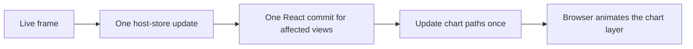

# Open-tray CPU investigation

Status: measurements and optimization in progress, 2026-10-26.

The native open tray reproduces the reported CPU cost. Initial controlled runs
measure about 9.4% of one core with the panel visible and untouched. WebContent
and the WebKit GPU process account for most of it. The GPU process number is CPU
time used by that process, not hardware GPU utilization.

The tray footer averages `self.cpu` over its chart window: 60 seconds at the
normal 1 s cadence, stretched when the sampling interval increases. It can mix
recent open and closed periods. The measurements below use process CPU-time
deltas over explicit windows, rather than reading that footer.

## Evidence and scope

Baseline source is `1249556`, with the same production code as 0.3.0. The local
release benchmark uses `com.tryopendata.kelvo.bench`, isolated from the installed
app and its data. The display is a MacBook Pro M3 Max internal Retina display at
120 Hz. Initial diagnostic runs measure 45 seconds after 15 seconds of warm-up.
The final pair measures 120 seconds after 60 seconds of warm-up.

| Original layout | Whole app CPU | WebContent | GPU process CPU | App process |
|---|---:|---:|---:|---:|
| Expanded | 9.3809% | 4.2091% | 2.3198% | 2.8472% |
| Compact | 9.3651% | 4.2728% | 2.4840% | 2.6081% |
| CPU expanded, other cards compact | 9.3528% | 4.4457% | 2.2758% | 2.6309% |

On-screen window snapshots and native logs verify the visible panel and 1 s
sampling. The first compact run hid during measurement and is excluded. Its
0.6433% result describes a mostly hidden app, not a compact-card improvement.
Samples are taken after CPU measurement so sampling overhead does not enter the
reported numbers. Evidence lives in `target/qa/tray-cpu/`.

The expanded sample directly captures `getBoundingClientRect` forcing layout,
`LegacyRenderSVG` layout and paint, and remote layer-tree updates. Merely choosing
CSS transforms had not eliminated that work.

### Final controlled native pair

The final candidate B2 and reverse original A3 launches continuously checked AC
power, open lid, the same active 1728 × 1117 display at 120 Hz, panel visibility
and 1 s cadence. No motion override was active. The candidate ran first, then
the original. CPU is percent of one core across the app and its helpers.

| Expanded tray | Original A3 | Candidate B2 |
|---|---:|---:|
| Whole-app CPU | 9.5208% | 4.9372% |
| WebContent CPU | 4.0856% | 2.4114% |
| GPU process CPU | 2.5131% | 0.4067% |
| App main-thread CPU | 1.4741% | 0.7655% |
| Engine-thread CPU | 0.8438% | 0.8463% |
| Physical footprint | 456.4 MB | 445.6 MB |

This pair measured a 48.1% reduction in open-tray CPU, with essentially unchanged
engine CPU. It supports a presentation improvement without reduced collection.
The user considers approximately 5% acceptable for the open tray. That does not
change the background product budget or any automated threshold.

After closing each panel, a separate 30 s warm-up and 60 s measurement recorded
0.9226% / 188.4 MB for the original and 0.9002% / 191.4 MB for the candidate.
GPU-process footprint fell from 267.9 to 16.6 MB originally and from 264.1 to
15.6 MB in the candidate. No retained GPU-backing increase was observed; total
closed footprint differed by 3 MB, mostly WebContent. These are warm, post-close
measurements, not a fresh-launch idle-budget pass. Both remain above the 0.5%
background product target.

Evidence directories are `final-ac-original-expanded-a3` and
`final-ac-composited-expanded-b2` under `target/qa/tray-cpu/`. The original app's
SHA-256 is `913a051b37531b9054305ca81b5819c98625e0450d1ee58908b2abaa8e880fe5`;
the candidate's is
`bd3435e839913511918523c687e7804a39fc9d7b5526be561a88b27381c5903d`.
Both hashes identify `Contents/MacOS/kelvo`, not an archive of the app bundle.
The advisory visible baseline remains unset: its contract requires at least five
clean measurements per scenario, which this final long-run pair does not supply.

Final 15 s warm-up / 45 s checks measured 3.8825% CPU and 407.0 MB for compact
cards, and 5.6085% / 410.4 MB for mixed cards. Both passed the visibility,
pause/settings and continuous power/display checks. These shorter cases establish
working density variants, not a second matched long-run comparison. An earlier
compact case was paused during warm-up; its 0.0731% number is invalid and excluded.

An earlier long pair measured 9.4816% and 5.3089%, but did not continuously record
power conditions; a battery-state observation followed its candidate run. It is
retained as supporting evidence with that limitation, not used as the final
controlled comparison. A reverse run refused to start with the lid reported closed.

## Rendering decisions

The data path already applies one store update per incoming live message. A
React Profiler test of the real popover through the mock transport verifies one
committed update per frame in expanded and compact layouts. CPU, GPU and Network
subtrees share the same commit time; a CPU-only value change leaves Memory
untouched. This proves committed update counts in the test environment, not
native paint cost or discarded speculative React renders.

The first candidate replaces write/read/write CSS transition restarts with Web
Animations keyframes. It preserves the existing duration and easing tokens,
skips zero-duration motion, and cancels an active slide on gaps or unmount.
Chromium and WebKit behavior tests detect the original forced geometry reads and
uncancelled gap animation, and pass with the candidate.

The retained implementation separates stationary chart grids from a moving HTML
wrapper around the series SVG. This gives the compositor an HTML animation target
while retaining chart paths, gaps, labels and accessible names. A motion-gated
`translateZ(0)` keeps this layer, and the network bar rows, backed between ticks.
Native samples of the wrapper alone still caught backing teardown; the promoted
candidate's sample did not. A short sample's absence is supporting evidence, not
a guarantee that teardown never happens.

The successive 45-second expanded runs measured 6.8212% with Web Animations,
6.5401% with the HTML wrapper, and 5.3614% with retained backing, versus 9.3809%
originally. Disabling motion at the same sampling cadence measured 4.0855% in the
Web Animations variant. These diagnostic runs locate costs; the longer controlled
pair is the acceptance comparison.

The layer policy is off in reduced motion and Performance mode. Active animations
are cancelled on a discontinuity, next update or unmount. Changing preferences
during an already-running 150 ms animation affects the next update; it does not
synchronously cancel that animation. Backing can remain while a mounted panel is
hidden, so the native comparison also measures closed-panel footprint. Neither
sampling nor recorded history changes.

A real-browser App/transport fixture also verifies one committed update per frame
with real ResizeObservers and without React `act` or `flushSync` batching. Browser
tests exercise both Chromium and WebKit. Visual comparisons cover all tray
densities, the neighboring CPU screen and the shared gallery in both themes.
No intentional visual differences remain. Some captures differ by one RGB level
without a perceptible layout or color change; the evidence records those rather
than treating the images as identical.

The native benchmark gains separate expanded, compact and mixed layouts, plus a
bench-only motion override. The latter changes motion tokens without changing
collector or frame cadence. Performance mode also changes collection periods, so
it cannot isolate animation cost.

Canvas was considered in response to the user's follow-up. Timeline already uses
uPlot; the tray's small SVG paths have not yet been compared against a canvas
replacement. A future experiment can retain HTML controls, labels and hit targets,
draw a pixel-ratio-scaled chart once per update, and animate its layer. That could
preserve resolution and interaction, but a saving over the optimized SVG version
is unmeasured. Canvas alone does not move drawing commands off the main thread;
worker rendering also does not by itself reduce total work. No canvas migration
is included in this change.

## Collection and storage

The existing architecture shares immutable frames and process batches, stops
hidden-window streams, and writes through one SQLite worker with cached
statements and batched transactions. Opening the local popover does not fan out
detail subscriptions to connected remote hosts. These findings do not justify a
storage or transport rewrite.

The measured writer cost was 0.03% CPU in the diagnostic open-tray runs. A focused
writer change reuses app identity IDs within each usage bucket, avoiding repeated
app upsert/lookup pairs for helper processes. The map expires after each bucket;
per-process writes and metadata timestamps remain intact.

A real-SQLite A/B/A microbenchmark of 120 buckets, each containing 300 processes
in 30 apps, including compressed flush, measured median times of 77.208 ms,
47.998 ms and 72.690 ms. The candidate saves 34–38% in that fixture, about
0.2 ms per 10 s bucket. This is a small storage efficiency gain and cannot explain
the open-tray CPU cost. Fixture, source snapshots and commands are retained under
`target/qa/tray-cpu/storage/`.

## Research used

- [React external-store subscriptions](https://react.dev/reference/react/useSyncExternalStore):
  stable snapshots and synchronous store updates explain why adding a transition
  around store notifications would not solve rendering cost.
- [Web Animations in Safari](https://webkit.org/blog/10266/web-animations-in-safari-13-1/):
  explicit keyframes avoid the style invalidation needed to restart a CSS effect.
- [Web content power usage](https://webkit.org/blog/8970/how-web-content-can-affect-power-usage/):
  inspect layout, rendering and painting separately; transform animations can
  use accelerated composition.
- [WebKit SVG animation report](https://www2.webkit.org/show_bug.cgi?id=227339):
  distinguishes SVG child animations from outer SVG/HTML animation targets.
  The installed native trace, rather than this historical report alone, motivates
  testing the wrapper.

## Review and verification

An independent Sol 6.1 agent applied the installed CE `code-reviewer` definition
and its architecture, error-handling and testing guidance to the complete tracked
and untracked batch. It returned APPROVE with no actionable architectural,
correctness, maintainability or test-design findings. This was a read-only source
review; it did not replace the execution checks below.

Native before/after measurements and chart/gallery visual checks are complete.
The full functional rerun passed all 492 Chromium/WebKit cases in 2.4 minutes,
with no retries, using a frozen checkout and retained failure traces. The remaining
work is the normal local push gate and hosted Linux checks.
No performance ceilings or product defaults have been raised.

The first full local browser run completed 479 of 492 cases successfully. Its
13 Chromium failures comprised blank Docker pages and stalled Disk queries or
fixture states. No animation assertion failed, but that does not establish an
unrelated cause. The log contains no observed HMR/reload evidence, and local
retries were disabled so failure traces were absent. Artifacts are preserved in
`target/qa/tray-cpu/checks/failed-browser-test-results` and
`failed-browser-report`. The full rerun passed without changing production code,
thresholds, selectors or timeouts. The original failures' cause remains unresolved.

The four new render-count tests pass. Deliberately widening Memory's subscription
made both density assertions fail with an unwanted Memory commit, then restoring
the production file byte-for-byte returned all four to green. An initial restored
run exposed a startup-query race in the test; it now waits for the visible public
IP control before counting streaming commits. The reviewer approved that readiness
fix. Original animation behavior fails the geometry-read/gap tests, and the old SVG
target fails the HTML-layer assertion. The storage preservation test also detects
a deliberate app-identity aliasing mutation. Logs and restoration hashes are under
`target/qa/tray-cpu/checks/selector-mutation/` and the other task evidence folders.
